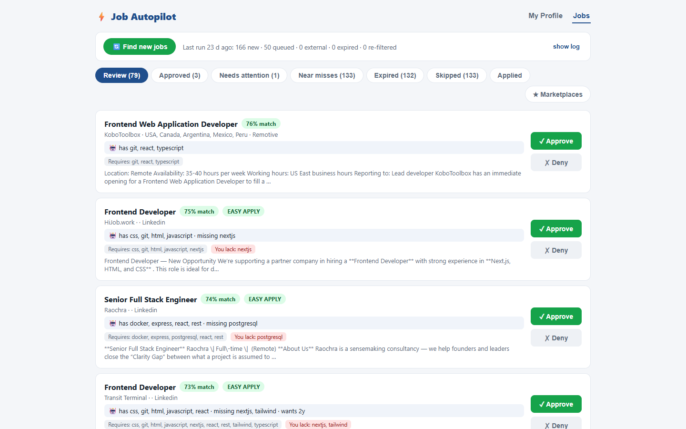
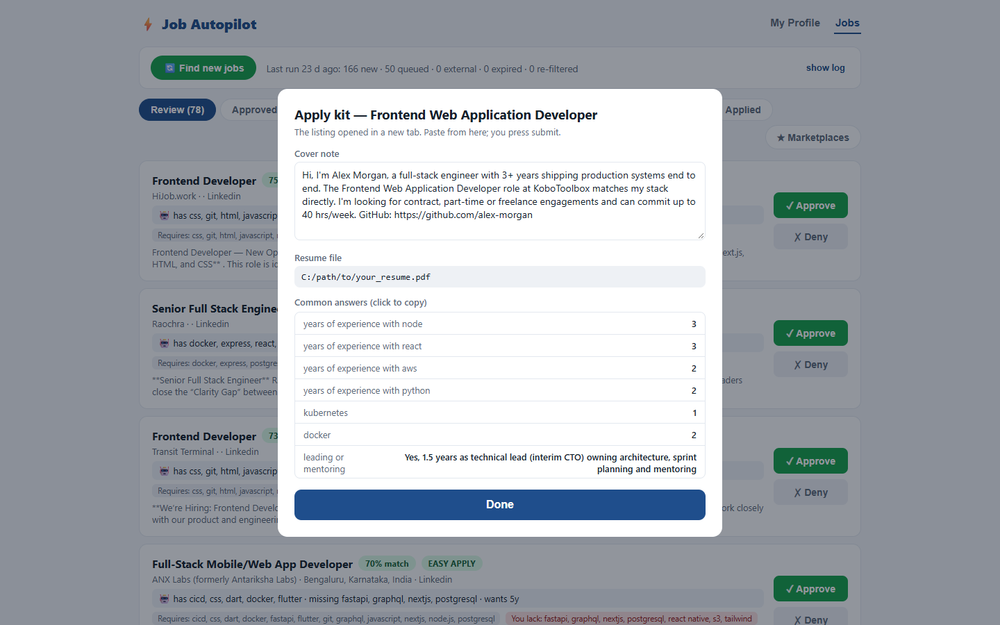
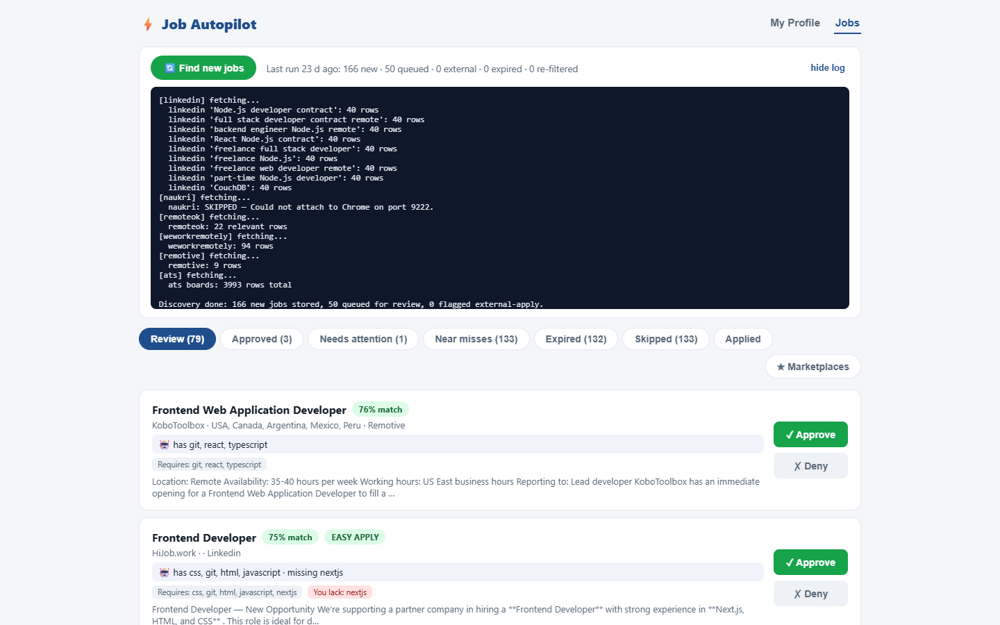
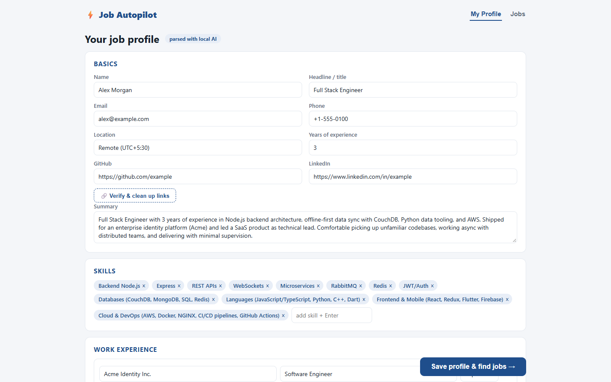
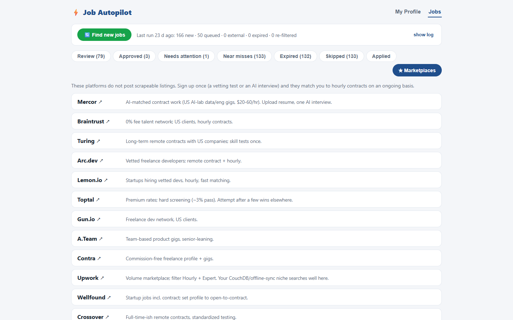
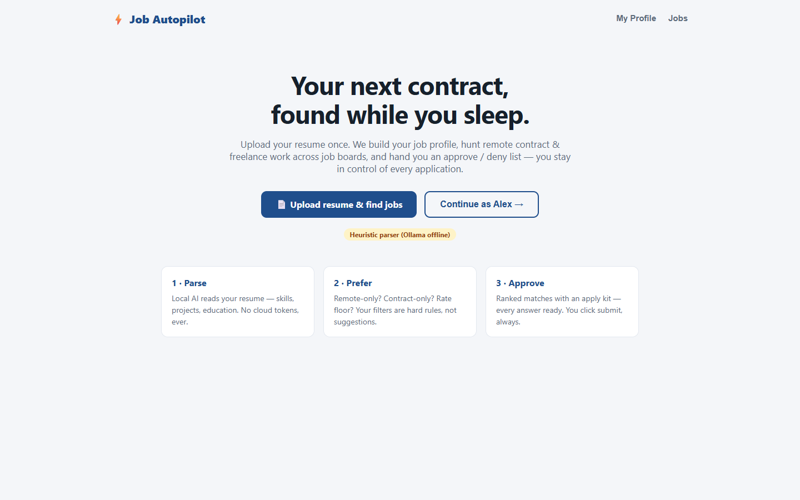
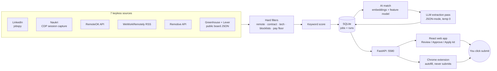

# Job Autopilot

[](https://github.com/agryashu23/job-autopilot/actions/workflows/ci.yml)

**A local-first, AI-ranked job pipeline for remote contract work.** It pulls
postings from seven sources, applies hard filters, ranks what survives with an
explainable scoring model built on local embeddings and a local LLM, and gives
you an approve/deny queue with a one-click apply kit and a Chrome autofill
extension.

It runs entirely on your own machine: no cloud APIs, no API keys, zero token
spend. A human submits every application.



<p align="center">
  <b>Python</b> · FastAPI · SQLite · <b>React</b> + Vite · Ollama (nomic-embed-text, qwen2.5:3b) ·
  Playwright / Chrome DevTools Protocol · Chrome Extension (MV3) · pytest
</p>

---

## Why I built it

Contract and freelance roles are scattered across LinkedIn, Naukri, remote-only
boards and hundreds of company career pages, and most "remote contract" results
are mislabeled full-time, hybrid or aggregator reposts. Sorting through them by
hand took hours a week. I wanted a system that:

1. **Never shows me a job that breaks my rules.** Remote-only, contract-only and
   a pay floor are hard constraints, not ranking hints.
2. **Explains every ranking.** "83% match: has aws, lambda, node.js; missing
   dynamodb" instead of an opaque number.
3. **Costs nothing to run** and keeps my resume and answers on my machine.
4. **Keeps me in control of submitting.** Automation prepares; the human submits.

## Screenshots

| Apply kit after approving | Discovery run with live log |
|---|---|
|  |  |

| Profile parsed from a resume by the local AI | Talent marketplaces with no listings to scrape |
|---|---|
|  |  |



<sub>The screenshots use an anonymized demo profile with real public job postings.</sub>

---

## Architecture



| Layer | What it does | Code |
|---|---|---|
| Discovery | Fetches, normalizes and dedupes postings from every source; records each run with its full log | `autopilot/discover.py`, `autopilot/sources_ats.py` |
| Filters and scoring | Deterministic hard filters, keyword weights, pay-rate extraction, near-miss parking with reasons | `autopilot/util.py` |
| AI match | Field-level embeddings, an 8-feature weighted model and an LLM requirement extractor | `autopilot/match.py`, `autopilot/features.py` |
| Lifecycle | Status machine (`new → queued → approved → applied`, plus `expired`, `needs_attention`) with TTL expiry | `autopilot/db.py` |
| API and UI | FastAPI backend serving a React SPA; resume parsing; background discovery runs | `server/`, `web/` |
| Assisted apply | Apply kit (cover note, resume path, click-to-copy answers) and an MV3 autofill extension | `server/main.py`, `extension/` |

---

## Engineering highlights

### 1. An explainable ranking model, not a black-box score
Each job is reduced to **eight named features**, each scored from 0 to 1, then
combined with weights you can tune in config:

| Feature | Signal |
|---|---|
| `must_have_coverage` | Share of the posting's required technologies you have, confidence-weighted: a post naming one technology counts for less than one naming eight |
| `role_title_semantic` | Cosine similarity between your role vector and the job-title vector |
| `skills_semantic` | Your skills vector against the job-body vector |
| `experience_years` | A curve comparing required years with yours, not a cliff |
| `skill_overlap` | Coverage of nice-to-have skills |
| `experience_domain` | Your experience vector against the job-body vector |
| `pay` | Advertised rate against your floor |
| `seniority` | Title seniority against your years |

The scorer returns each feature's **contribution** as well as the total, so the
UI can say exactly why a job ranked where it did. A job whose *primary*
technology isn't yours is down-weighted by 30%.

### 2. Field-level embeddings instead of one blob
Embedding a whole resume against a whole posting blurs everything together. The
profile is embedded as three separate vectors (**role, skills, experience**) and
each job as two (**title, body**). Similarity is computed per meaningful pair,
then rescaled to the model's real operating range (cosine ≈ 0.35–0.80 for
`nomic-embed-text`). The model's task prefixes (`search_query:` /
`search_document:`) are applied correctly, which measurably improves retrieval.

### 3. "Let the model extract, let code decide"
I first had a 3B-parameter local model judge fit directly, and tried three
prompt designs. It drifted generous, then parroted rejection rules, then
anchored on the prompt's example. The fix that worked: the LLM only **extracts
structured facts** (required stack, years, seniority) in JSON mode at
temperature 0, and **plain Python computes the fit**. Same inputs give the same
score every time, with a readable reason. Numeric facts such as years and pay
are compared arithmetically and never embedded, because a vector doesn't
preserve magnitude.

### 4. Getting data out of hostile or unusual sources
- **Naukri** blocks direct API calls (HTTP 406 from its bot protection). Instead
  of fighting it, discovery attaches to a real Chrome session over the **Chrome
  DevTools Protocol** and captures the site's own search-API responses.
- **LinkedIn**'s "Easy Apply" filter leaks promoted posts that send you off-site.
  These are detected at discovery from the posting's direct apply URL, tagged
  `EXTERNAL`, and known aggregators are blocked by company name.
- **Greenhouse and Lever** company boards are read through their official public
  JSON (about 4,000 postings per run across the configured companies), with dead
  board tokens reported in the run log.

### 5. Hard constraints stay hard
High embedding similarity on a recruiter or VBScript role is noise, not fit. AI
promotion into the review queue **still has to pass the deterministic filters**.
Changing the config re-filters waiting jobs on the next run, so the queue cleans
itself without a reset.

### 6. A reliable local system
- **Run history:** every discovery run is stored with a summary and full log and
  shown live in the UI.
- **Lifecycle expiry:** approved-but-unapplied jobs expire after 14 days and
  unreviewed jobs after 21, so the queue never fills with dead postings.
- **Graceful degradation:** if Ollama is offline, discovery falls back to keyword
  scoring and resume parsing falls back to heuristics.
- **Locked-down local API:** CORS allows only `chrome-extension://` and
  localhost, so another website open in the browser can't read your profile
  from the local server.
- **Answer-bank consistency:** "total years" is automatically kept at or above
  every per-skill answer, so you never claim "3 years React, 2 years total".

### 7. Resume → structured profile, fully local
`pdfplumber` text extraction plus regex heuristics handle the predictable cases
(contact info, section headers, date ranges) instantly. A local
`qwen2.5:3b` pass then cleans up the messy remainder asynchronously while the UI
polls for the result.

### 8. Assisted applying with a clear compliance line
The **Chrome extension** fills text fields, selects and radio buttons on any
application page from your profile and answer bank, including React-controlled
inputs (native value-setter plus synthetic events). It highlights the resume
upload and lists questions it couldn't answer. It has no code path that submits
a form. Unknown questions go into `answers.yaml` and get filled next time.

---

## Quick start

```powershell
git clone https://github.com/agryashu23/job-autopilot.git
cd job-autopilot
python -m venv .venv
.venv\Scripts\Activate.ps1
pip install -r requirements.txt

# Personal files are git-ignored; start from the templates
copy config.example.yaml config.yaml
copy answers.example.yaml answers.yaml

# Optional local AI (free, runs offline)
ollama pull nomic-embed-text
ollama pull qwen2.5:3b

python run.py web      # http://localhost:5580 → upload resume → Find new jobs
```

Load the extension from `chrome://extensions` → *Load unpacked* → `extension/`.

### Commands

```
python run.py web                       # web app on :5580
python run.py discover                  # fetch, filter, score and AI-match
python run.py match                     # re-run AI matching only
python run.py stats                     # status counts + recent runs
python run.py test                      # unit tests
python run.py schedule | unschedule     # optional daily run via Windows Task Scheduler
python run.py chrome                    # debug Chrome for Naukri discovery
```

### Configuration

| File | Purpose | In git? |
|---|---|---|
| `config.example.yaml` → `config.yaml` | Search terms, hard filters, pay floor, blocklists, scoring weights, sources, ATS companies, cover-note template | template only |
| `answers.example.yaml` → `answers.yaml` | Questionnaire answer bank (first matching phrase wins) | template only |
| `profile.json` | Your parsed profile and preferences, edited in the web app | no |
| `jobs.db` | SQLite store of jobs and run history | no |

## Project layout

```
autopilot/     discovery, sources, filters, feature model, AI match, SQLite layer
server/        FastAPI app, resume parser, Ollama client, link validator
web/           React + Vite SPA (built output committed in web/dist)
extension/     Chrome MV3 autofill extension
tests/         pytest: filters, external-apply detection, pay floor, lifecycle, run log
docs/          OVERVIEW.md (a beginner-friendly deep dive), screenshots
run.py         single CLI entry point
```

## Testing

```
python run.py test
```

14 unit tests (run by CI on Linux and Windows, Python 3.12 and 3.13) cover the contract-signal filter, external-apply detection
(including LinkedIn's safety-redirect unwrapping), pay-rate extraction and the
USD floor, aggregator blocking, Greenhouse HTML cleanup, lifecycle expiry, status transitions and
run-history bookkeeping (including closing runs whose process died).

## Design decisions I'd defend in a review

- **SQLite over a server database:** a single user, local, zero ops. The status
  machine and run log fit comfortably.
- **Local models over a cloud LLM:** resumes are personal data, and per-call
  token cost adds up across thousands of postings. A 3B model is enough once it
  only does extraction.
- **Deterministic scoring over LLM judgment:** reproducible, debuggable and
  explainable. You can unit-test it.
- **Assisted apply over auto-submit:** the Playwright auto-apply bot exists
  (`run.py apply --yes`) but is opt-in and unmaintained. Human submission keeps
  accounts safe and applications genuine.

## Roadmap

- Learn from approve/deny history to tune feature weights per user
- Per-company ATS discovery (find which board a company uses automatically)
- Packaged desktop build (a tray app and a one-click Ollama setup)
